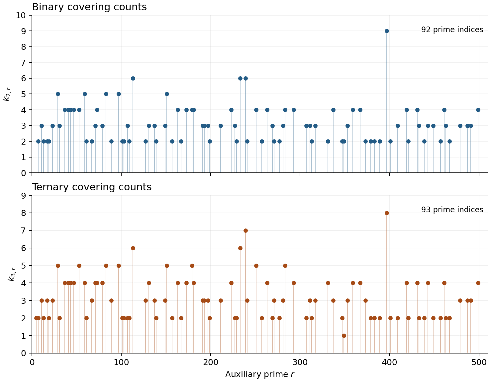
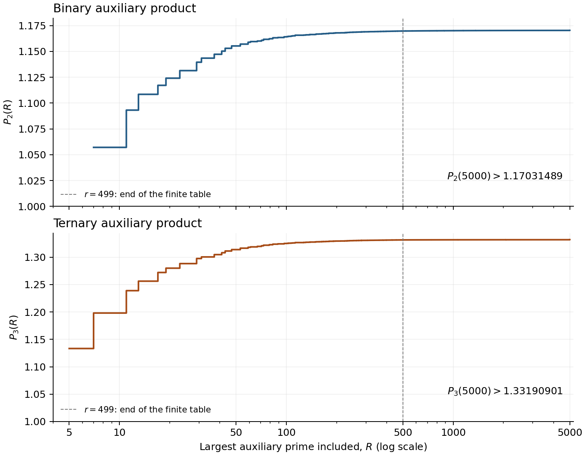

# A prime and powers of fixed bases

Computational files for the manuscript by **Cristian Cobeli, Nicolas Robles, and Alexandru Zaharescu**.

This repository reproduces the finite computations used in the manuscript. It includes the rational allocation witnesses, exact verification programs, the three numerical tables, generated result files, and figures. The allocation data were extracted from version 13 and are unchanged in the later versions. Further checks were added for version 19 (the density bound for the balanced-triple sieve and the least base-three exception) and for version 20 (the common sums of two pairs of bases and the counts of the numerical table).

## Run the verification

Python 3.9 or later is sufficient. The verification programs use only the Python standard library.

Clone the repository and run the verification:

```sh
git clone https://github.com/nicolasrobles/a_prime_and_powers_of_fixed_bases.git
cd a_prime_and_powers_of_fixed_bases
python3 verify_all.py
```

The command verifies both finite allocations, all auxiliary order calculations, the resulting products and constants, the introductory arithmetic, the balanced-triple density bound, the least base-three exception, the congruences for common sums, and the counts for two distinct bases. It takes under a minute and uses about 200 MB of memory; both figures depend on the Python version and the machine. It writes the complete results to `results/`. A failed check stops with an error and a nonzero exit status. Run Python normally, without `-O`, because the programs use assertions.

To reproduce the results in a separate directory, run:

```sh
python3 verify_all.py --output-dir _verification_tmp
```

A complete run writes nine canonical JSON files: `allocation_finite_exact.json`, `allocation_tail_exact.json`, `coefficient_checks.json`, `full_recursion_comparison.json`, `intro_checks.json`, `balanced_sieve.json`, `base3_minimality.json`, `common_sums.json`, and `odd_sum_counts.json`. Corresponding JSON values in the fresh directory and `results/` should agree.

The programs named in the manuscript can also be run separately:

```sh
python3 verify_binary_cover.py
python3 verify_ap.py
python3 verify_binary_tail.py
python3 verify_ap_tail.py
python3 verify_balanced.py
python3 verify_base3_minimality.py
python3 verify_common_sums.py
python3 count_odd_sums.py
```

The cover programs check the finite rational allocations. The tail programs check the auxiliary prime counts, covering counts, products, and final constants. `verify_balanced.py` determines the 626 primes of the balanced-triple sieve and proves the density bound of Lemma 5.1. `verify_base3_minimality.py` proves both assertions of Theorem 1.5. `verify_common_sums.py` checks the three congruences of Proposition 7.1, and `count_odd_sums.py` recomputes the counts of Table 5. The additional command

```sh
python3 verify_intro.py
```

checks the stated base-three counterexample and the congruences for the pairs of distinct bases. It factors the 153 differences for the candidate $118\,514\,161$; minimality is the subject of `verify_base3_minimality.py`.

Every entrypoint resolves its input files relative to the repository, so it can also be invoked by absolute path from another directory. Use `--output-dir DIR` to direct the generated files elsewhere. The single-case commands use separate output filenames and preserve the complete result files produced by `verify_all.py`.

## Verified finite results

| Check | Binary case | Ternary case |
|---|---:|---:|
| Prescribed prime entries | 41 | 30 |
| Capacity inequalities | 36 | 25 |
| Surviving exponent pairs | 20,548 | 2,966 |
| Auxiliary order calculations | 828 | 1,302 |
| Finite covering counts | 92 | 93 |
| Claimed allocation constant $Z_i$ | 2.081483 | 2.287407 |
| Minimum normalized coverage | 2.081485088640 | 2.287407403584 |

There are 61 distinct primes across the 71 prescribed entries. Each prime is proved prime by complete trial division, and each stated multiplicative order is checked exactly.

The final coefficients satisfy

$$
1.642042484284197982<C_2<1.642042484284197983,
$$

$$
0.492349222099757667<C_3<0.492349222099757668.
$$

In particular, $C_2<1.642043$ and $C_3<0.492350$. All acceptance checks use integers or rational numbers. Decimal conversions in progress messages and plots are for display.

The introductory checker also verifies all 153 unordered exponent pairs for the base-three candidate, the 39 empty classes and one sparse class modulo 600 for $(599,601)$, and the 260 classes with a coprime prime residue. The analytic density statements use the arguments in the manuscript.

For the balanced-triple sieve, 870 primes up to 50000 satisfy the condition on the order of 2, and 626 of them divide some $1+2^{h_1}+2^{h_2}$ with admissible exponents. The density of the surviving residue pairs satisfies

$$
\varrho\le\frac{1623190827888387}{6400000000000000}<0.253624,
$$

and its exact value is $0.25362356684502987\ldots$

For base three, $N=118\,514\,161$ is not a prime power plus two powers of 3 with nonnegative exponents, and each of the 39,504,717 odd integers $n$ coprime to 3 with $10<n<N$ is a prime plus two positive powers of 3.

For two distinct bases, the integer 18 is the only one of the form $5^j+13^k$ and of the form $7^a+11^b$ with positive exponents, and no integer is of the form $17^j+19^k$ and of the form $599^a+601^b$. The counts of odd integers $p+q_1^j+q_2^k$ up to $10^7$ and $10^8$ are in `results/odd_sum_counts.json`; they are numerical data and no proof depends on them.

## Files

| Path | Contents |
|---|---|
| `binary_cover_1440_full.json` | Original sparse binary allocation witness, with denominator $10^{12}$. |
| `ap_certificate.json` | Original sparse ternary allocation witness, with denominator $10^{12}$. |
| `data/tables_v13.json` | The prescribed primes, their orders and residues, and the auxiliary covering counts extracted from v13. |
| `data/source_manifest.json` | Source identity and input hashes. |
| `scripts/verification.py` | Shared exact verification routines used by the root entrypoints. |
| `scripts/balanced_sieve.py` | The balanced-triple sieve: the set of 626 primes and the density bound. |
| `scripts/base3_minimality.py` | The base-three candidate and the exhaustive search below it. |
| `scripts/common_sums.py` | The congruences for the common sums of two pairs of bases. |
| `scripts/odd_sum_counts.py` | Counts of odd integers that are a prime plus powers of two distinct bases. |
| `results/` | Full exact results, including order witnesses, capacity slacks, minima, prime-factor counts, and coefficient bounds. |
| `tables/` | CSV and LaTeX versions of the numerical tables and summaries. |
| `plots/` | PNG and SVG figures, with captions explaining their content. |
| `notebooks/reproduce_v13.ipynb` | A notebook that runs the verification and presents the results. |
| `docs/methods.md` | Definitions, arithmetic, and mathematical inputs used by the programs. |
| `docs/versioning.md` | How the files are tied to v13 and to the later recorded revisions. |

The field `certified_gamma` in the original ternary witness reads `"2.2874"`. The verifier checks the stronger v13 target **2.287407** against the actual entries. The supplied witness is preserved unchanged.

## Tables, figures, and notebook

Regenerate the tables with:

```sh
python3 scripts/make_tables.py
```

To regenerate the figures, install the optional plotting dependency and run:

```sh
python3 -m pip install -r requirements-figures.txt
python3 scripts/make_plots.py
```

The plots show the certified covering counts through 499 and the partial rational products through 5000. Their captions identify the finite quantities being plotted. The exact result files contain the comparisons used in the proofs.

Open `notebooks/reproduce_v13.ipynb` in Jupyter and run its cells in order. It uses the same Python verification programs and reads their output. Jupyter is needed only to use the notebook interface.





The GitHub Actions workflow runs the exact verification and regenerates the tables on pushes and pull requests. Its run history is available on the [Actions page](https://github.com/nicolasrobles/a_prime_and_powers_of_fixed_bases/actions).

## Scope

The finite allocations and auxiliary calculations correspond to Section 4 of the manuscript, the balanced-triple sieve to Lemma 5.1, the base-three search to Theorem 1.5, and the congruences for common sums to Proposition 7.1. Their use in the proofs also requires the mathematical lemmas in the manuscript. The programs verify the finite inequalities and the stated arithmetic inputs.

The manuscript sources are identified by their SHA-256 digests. The tables were extracted from v13:

```text
af63bc8cb54d4ba3b2e93d6b068d223fce2c822a521640568a353e6a312b7df7
```

They were compared again with the later revisions recorded in `data/source_manifest.json` (v19, v20, v21 and v23), in which they are unchanged. If one of these sources is available locally, its tables can be compared with the repository inputs:

```sh
python3 scripts/check_source_tables.py /path/to/prime_and_fixed_base_powers_v23.tex
```

For a source that is not recorded in `data/source_manifest.json`, add `--rows-only` to compare the table entries only.

See [the methods](docs/methods.md) for the verification steps and [the versioning notes](docs/versioning.md) for the provenance of the data.
